# 教师工作量管理系统

> 🎓 **计算机毕业设计 · 教师工作量管理系统**
>
> 本仓库只放**项目介绍 + 运行截图**（截图是站点带水印的原图，存在仓库 `images/` 里）。
>
> 👉 **完整可运行源码 / 数据库脚本 / 部署文档：[点我获取](https://geekcode.top/archives/%E6%95%99%E5%B8%88%E5%B7%A5%E4%BD%9C%E9%87%8F%E7%AE%A1%E7%90%86%E7%B3%BB%E7%BB%9F?utm_source=github)**
>
> 💬 咨询微信：**ir9372**　|　🌐 更多项目：[极客代码 geekcode.top](https://geekcode.top/?utm_source=github)
>
> 📌 项目详情页：<https://geekcode.top/archives/%E6%95%99%E5%B8%88%E5%B7%A5%E4%BD%9C%E9%87%8F%E7%AE%A1%E7%90%86%E7%B3%BB%E7%BB%9F?utm_source=github>

<table><td width="230" align="center"> <b>扫码加微信 ir9372</b></td><td valign="middle">📦 源码 = 项目介绍 + 全部运行截图 + 数据库 + 部署文档 👉 点上方任意截图，直接跳到 <b>极客代码 geekcode.top</b> 详情页</td></table>

---

<h1>教师工作量管理系统</h1>
<h2>项目概述</h2>

本项目为“教师工作量管理系统”，旨在解决高校或教育机构中教师教学、科研等工作量统计繁琐、数据分散及查询不便的问题。系统采用前后端分离架构，基于 Spring Boot 和 Vue 技术栈构建，实现了从后台数据管理到前台用户展示的全流程闭环。核心功能涵盖课程信息管理、工作量记录与统计、系统公告发布以及分类信息维护。适用人群包括教务管理人员（后台操作）和广大教师用户（前台查询与管理）。通过 Shiro 实现权限控制，MyBatis-Plus 优化数据持久层，确保系统的高效性与安全性，提升学校行政管理的数字化水平。

<h2>技术架构</h2>

本系统采用经典的前后端分离模式进行开发，整体架构清晰，耦合度低，便于维护与扩展。

<strong>1. 后端架构</strong>

<ul>
<li><strong>核心框架</strong>：基于 Spring Boot 快速搭建应用骨架，利用其自动配置特性简化开发流程。</li>
<li><strong>持久层</strong>：采用 MyBatis-Plus 作为 ORM 框架，配合 mysql-connector-java 驱动连接 MySQL 数据库。MyBatis-Plus 提供了通用的 CRUD 接口，显著减少了样板代码，提升了开发效率。同时引入 protobuf-java 以支持高性能的数据序列化需求。</li>
<li><strong>安全模块</strong>：集成 Apache Shiro 进行身份认证与授权管理，确保只有经过验证的用户才能访问受保护的资源，保障系统数据安全。</li>
<li><strong>通用组件</strong>：使用 commons-lang3 提供丰富的工具类方法，validation-api 用于参数校验，保证输入数据的合法性。</li>
</ul>

<strong>2. 前端架构</strong>

<ul>
<li><strong>框架选型</strong>：前端采用 Vue.js 框架构建单页面应用（SPA），结合 Element UI 等组件库实现响应式界面布局。</li>
<li><strong>交互逻辑</strong>：通过 Axios 发送 HTTP 请求与后端 RESTful API 进行数据交互，实现动态内容加载与状态管理。</li>
</ul>

<strong>3. 数据库设计要点</strong>

<ul>
<li>数据库主要包含教师表、课程信息表、工作量记录表、公告表、分类信息表及系统配置表。</li>
<li>各表之间通过外键或业务ID关联，例如工作量记录需关联具体教师与课程，确保数据的完整性与可追溯性。</li>
</ul>

<a href="https://geekcode.top/archives/%E6%95%99%E5%B8%88%E5%B7%A5%E4%BD%9C%E9%87%8F%E7%AE%A1%E7%90%86%E7%B3%BB%E7%BB%9F?utm_source=github" title="查看完整源码">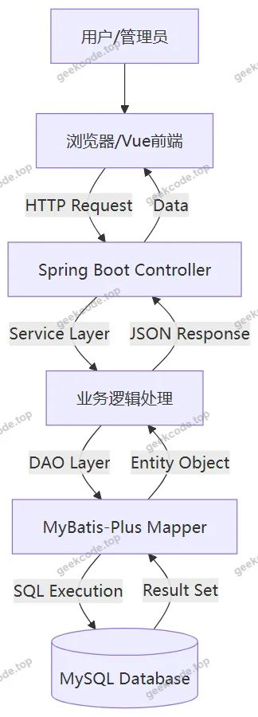</a>

<h2>功能模块</h2>

根据源码中的 Controller 列表及截图所示的功能界面，系统分为前台用户端和后台管理端两大板块。

<h3>前台用户端</h3>

前台主要面向普通用户（如教师），提供信息查询与个人中心服务。

<ol>
<li><strong>首页展示</strong>：聚合显示系统最新公告、热门课程信息及关键统计数据，提供便捷的入口导航。</li>
<li><strong>注册与登录</strong>：提供用户账号注册功能及身份认证登录界面，确保用户身份合法后方可进入系统。</li>
<li><strong>课程信息浏览</strong>：</li>
</ol>
<ul>
<li><strong>列表页</strong>：展示所有公开的课程基本信息，支持按条件筛选。</li>
<li><strong>详情页</strong>：查看特定课程的详细资料，包括课程名称、简介及相关属性。</li>
</ul>
<ol start="4">
<li><strong>系统公告浏览</strong>：</li>
</ol>
<ul>
<li><strong>列表页</strong>：滚动展示学校或部门发布的各类通知、政策变动等信息。</li>
<li><strong>详情页</strong>：阅读公告的完整内容及发布时间。</li>
</ul>
<ol start="5">
<li><strong>分类信息查看</strong>：展示系统中预设的各类别信息汇总，帮助用户快速定位资源。</li>
<li><strong>工作量查询</strong>：</li>
</ol>
<ul>
<li><strong>列表页</strong>：用户可查看自己或他人的工作量记录概览。</li>
<li><strong>详情页</strong>：查看具体某次工作量的详细信息，包括课时数、计算依据等。</li>
</ul>
<ol start="7">
<li><strong>个人中心</strong>：用户可在此模块查看和管理个人账户信息，修改密码或更新基本资料。</li>
</ol>
<h3>后台管理端</h3>

后台主要面向管理员，负责系统数据的维护与配置。

<ol>
<li><strong>后台登录</strong>：管理员专用登录入口，通过 Shiro 鉴权后进入管理控制台。</li>
<li><strong>仪表盘（首页）</strong>：展示系统运行状态、数据统计概览及快捷操作入口。</li>
<li><strong>课程信息管理</strong>：对系统中的课程数据进行增删改查操作，维护基础教学资源库。</li>
<li><strong>教师信息管理</strong>：录入、编辑或删除教师档案，确保人员数据的准确性。</li>
<li><strong>工作量管理</strong>：审核、录入或调整教师的工作量记录，支持批量处理与异常修正。</li>
<li><strong>系统公告管理</strong>：发布新的通知公告，编辑或删除历史公告，控制前台可见性。</li>
<li><strong>分类信息管理</strong>：维护系统的分类标签或类别结构，支持自定义分类层级。</li>
<li><strong>配置文件管理</strong>：修改系统全局参数配置，如网站标题、Logo、联系方式等基础设置。</li>
</ol>
<h2>用户角色与权限</h2>

系统基于 Shiro 框架实现细粒度的权限控制，主要划分为两种角色：普通用户（教师）和系统管理员。

<strong>1. 普通用户（教师）</strong>

<ul>
<li><strong>访问范围</strong>：仅限前台界面及个人中心。</li>
<li><strong>具体权限</strong>：</li>
<li><strong>浏览权限</strong>：可查看全部公开的课程信息、系统公告、分类信息及工作量列表（视隐私策略而定，通常仅看自己的详情）。</li>
<li><strong>个人管理</strong>：可在“个人中心”修改自身的部分账户信息。</li>
<li><strong>无写入权限</strong>：不可直接修改后台数据库中的核心业务数据（如课程定义、他人工作量）。</li>
</ul>

<strong>2. 系统管理员</strong>

<ul>
<li><strong>访问范围</strong>：拥有后台全部路由权限，并可查看前台所有内容。</li>
<li><strong>具体权限</strong>：</li>
<li><strong>数据维护</strong>：对 <code>Kechengxinxi</code>（课程）、<code>Jiaoshi</code>（教师）、<code>Gongzuoliang</code>（工作量）、<code>News</code>（公告）、<code>Fenleixinxi</code>（分类）进行完整的 CRUD（创建、读取、更新、删除）操作。</li>
<li><strong>系统配置</strong>：通过 <code>ConfigController</code> 修改系统全局配置参数。</li>
<li><strong>文件管理</strong>：通过 <code>FileController</code> 上传和管理系统所需的图片、文档等资源文件。</li>
<li><strong>用户管理</strong>：虽未在独立 Controller 中明确列出复杂的用户角色切换，但管理员具备最高权限，可介入处理用户相关问题。</li>
</ul>
<h2>项目特色与创新点</h2>
<ol>
<li><strong>一体化管理工作流</strong>：将传统的线下纸质或 Excel 工作量统计转化为线上自动化流程。教师在前台即可实时查询工作量明细，减少沟通成本；管理员在后台统一维护，确保数据口径一致。</li>
<li><strong>模块化与可扩展性</strong>：基于 Spring Boot + MyBatis-Plus 的技术组合，使得新增业务模块（如未来可能增加的科研项目管理）变得极其简单，只需添加对应的 Entity、Mapper 和 Service 即可复用现有架构。</li>
<li><strong>安全可靠的权限体系</strong>：引入 Apache Shiro 而非简单的 Session 验证，提供了更成熟的认证授权机制，有效防止越权访问，保障了敏感的教师数据和工作量记录的安全性。</li>
<li><strong>友好的用户体验</strong>：前端采用 Vue 框架，实现了页面局部刷新和无感跳转，相比传统 JSP 页面加载速度更快，交互更流畅。同时，清晰的导航菜单（课程、公告、个人中心）降低了用户的学习成本。</li>
</ol>
<h2>部署环境</h2>

为确保系统正常运行，需要以下软件环境支持：

<ol>
<li><strong>Java 运行环境</strong>：</li>
</ol>
<ul>
<li>JDK 版本：建议 JDK 1.8 或以上（兼容 Spring Boot 2.x 系列）。</li>
</ul>
<ol start="2">
<li><strong>数据库服务</strong>：</li>
</ol>
<ul>
<li>MySQL 版本：建议 MySQL 5.7 或 MySQL 8.0。</li>
<li>需提前创建数据库并导入初始化 SQL 脚本以建立表结构。</li>
</ul>
<ol start="3">
<li><strong>Web 服务器</strong>：</li>
</ol>
<ul>
<li>内置 Tomcat（由 Spring Boot Starter Web 提供），无需额外安装独立 Tomcat。</li>
</ul>
<ol start="4">
<li><strong>前端运行环境</strong>：</li>
</ol>
<ul>
<li>Node.js：建议 v14.0 以上版本，用于编译 Vue 前端代码。</li>
<li>npm/yarn：包管理工具，用于安装前端依赖。</li>
</ul>
<ol start="5">
<li><strong>其他依赖</strong>：</li>
</ol>
<ul>
<li>Maven：用于后端项目的依赖管理和打包构建。</li>
<li>浏览器：Chrome、Firefox、Edge 等现代主流浏览器，以获得最佳显示效果。</li>
</ul>
<h2>五、技术特性</h2>
<ul>
<li>前后端集成部署，前端资源打包至后端 static 目录</li>
<li>使用 MyBatis-Plus 简化数据访问层开发</li>
<li>集成 Shiro 权限框架实现角色权限控制</li>
</ul>
<h2>六、功能模块截图</h2>
<h3>前台用户端</h3>
<h4>前台首页</h4>

<a href="https://geekcode.top/archives/%E6%95%99%E5%B8%88%E5%B7%A5%E4%BD%9C%E9%87%8F%E7%AE%A1%E7%90%86%E7%B3%BB%E7%BB%9F?utm_source=github" title="查看完整源码">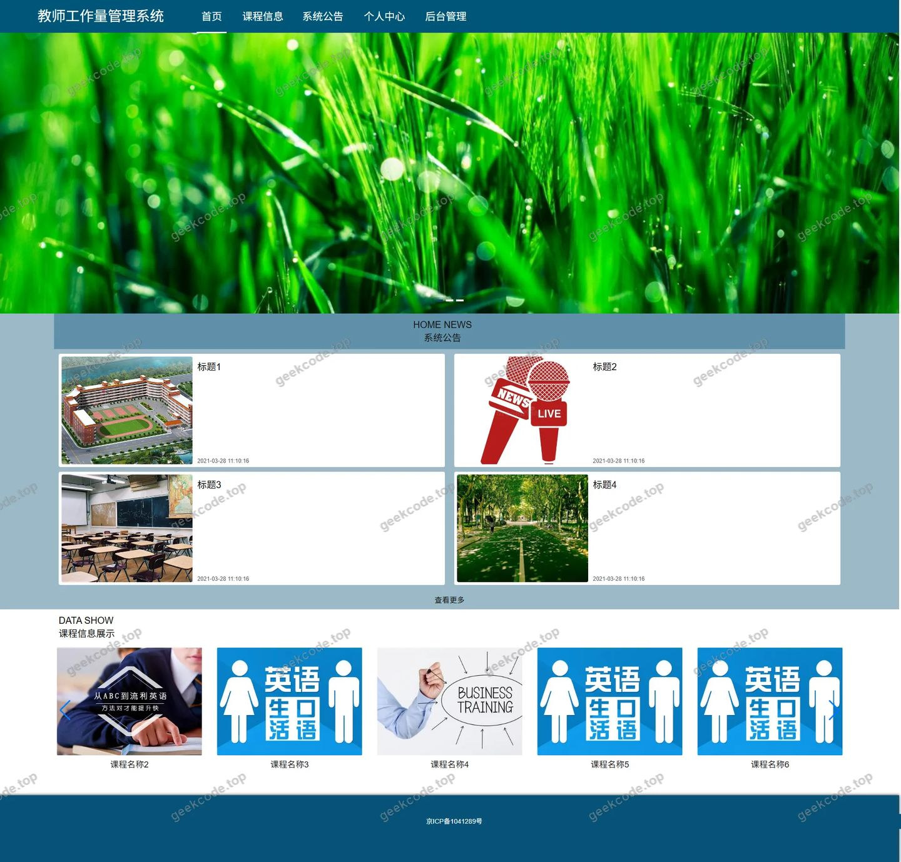</a>

<h4>前台注册页</h4>

<a href="https://geekcode.top/archives/%E6%95%99%E5%B8%88%E5%B7%A5%E4%BD%9C%E9%87%8F%E7%AE%A1%E7%90%86%E7%B3%BB%E7%BB%9F?utm_source=github" title="查看完整源码">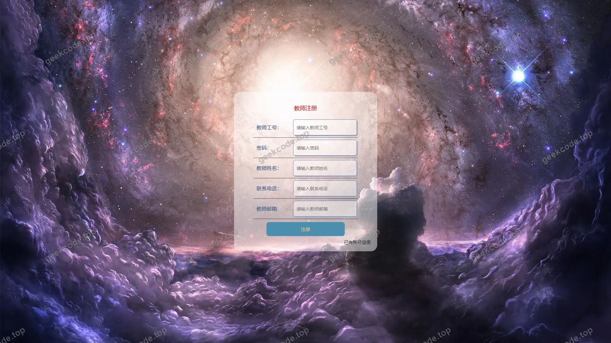</a>

<h4>前台登录页</h4>

<h4>前台-课程信息列表</h4>

<h4>前台-系统公告列表</h4>

<a href="https://geekcode.top/archives/%E6%95%99%E5%B8%88%E5%B7%A5%E4%BD%9C%E9%87%8F%E7%AE%A1%E7%90%86%E7%B3%BB%E7%BB%9F?utm_source=github" title="查看完整源码">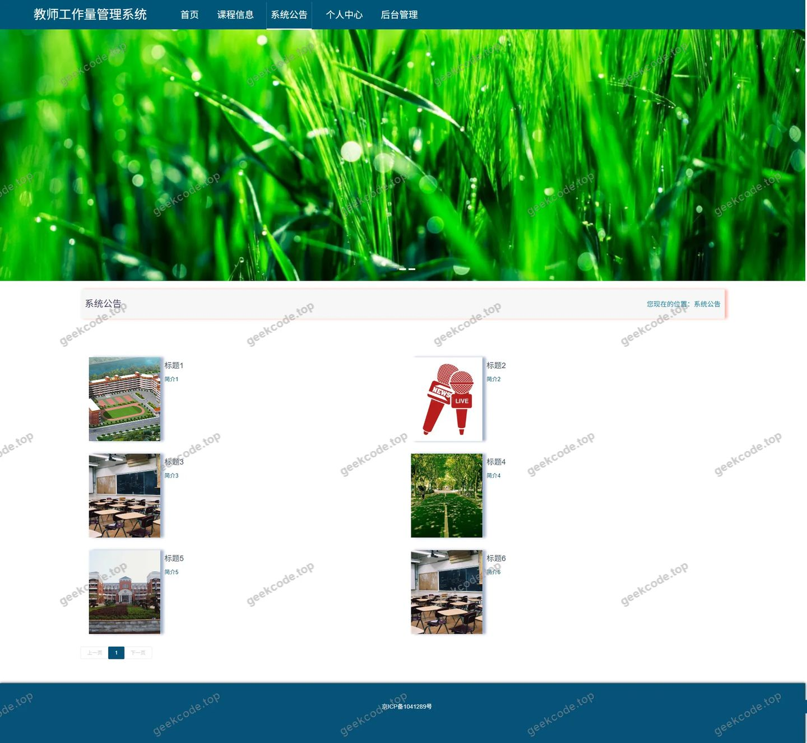</a>

<h4>前台个人中心</h4>

<a href="https://geekcode.top/archives/%E6%95%99%E5%B8%88%E5%B7%A5%E4%BD%9C%E9%87%8F%E7%AE%A1%E7%90%86%E7%B3%BB%E7%BB%9F?utm_source=github" title="查看完整源码">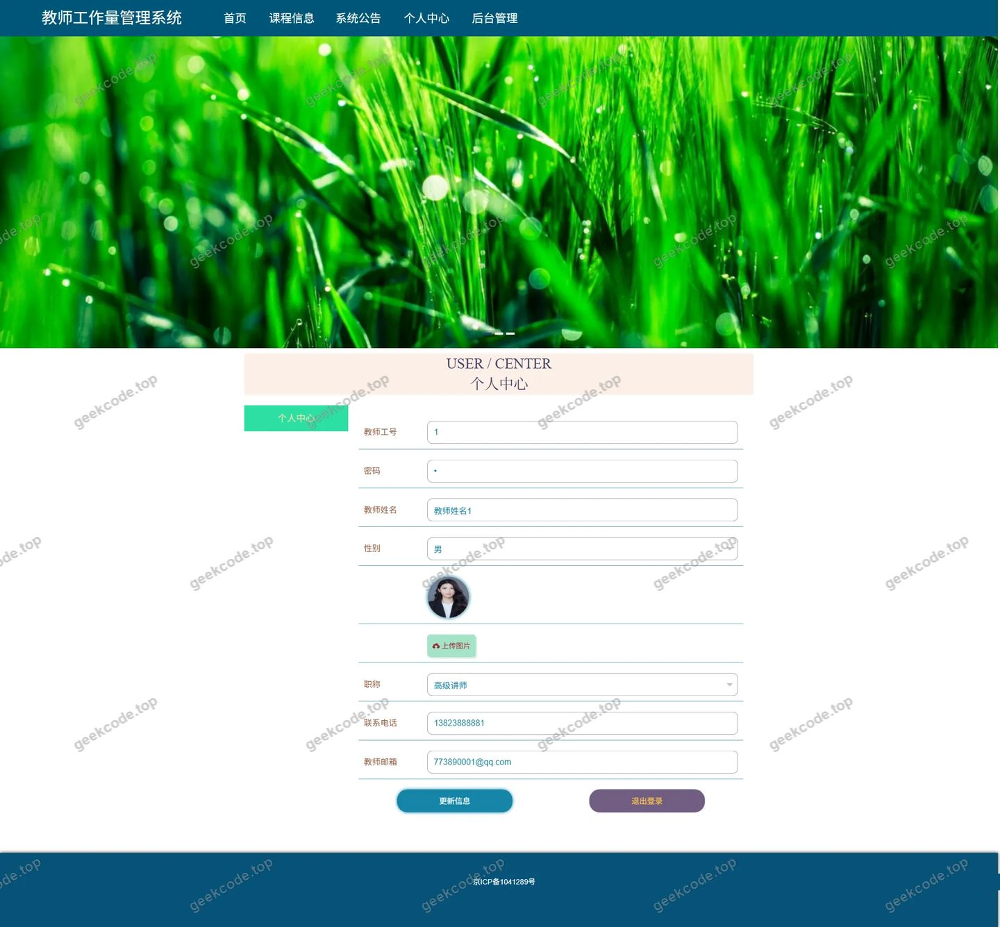</a>

<h4>前台-课程信息-详情</h4>

<a href="https://geekcode.top/archives/%E6%95%99%E5%B8%88%E5%B7%A5%E4%BD%9C%E9%87%8F%E7%AE%A1%E7%90%86%E7%B3%BB%E7%BB%9F?utm_source=github" title="查看完整源码">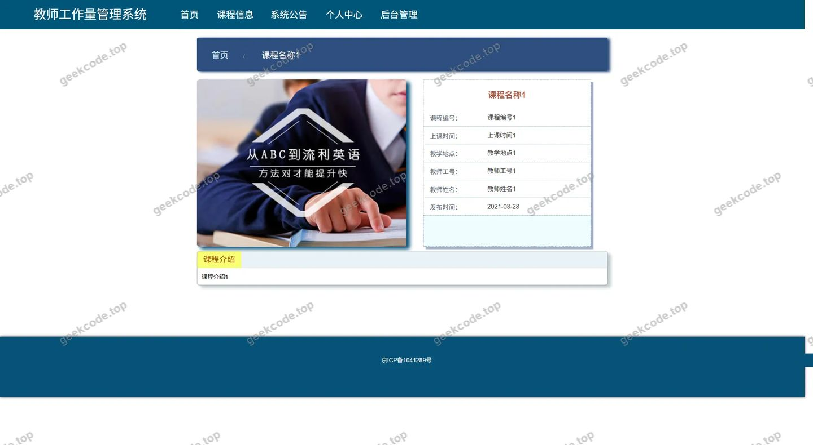</a>

<h4>前台-系统公告-详情</h4>

<a href="https://geekcode.top/archives/%E6%95%99%E5%B8%88%E5%B7%A5%E4%BD%9C%E9%87%8F%E7%AE%A1%E7%90%86%E7%B3%BB%E7%BB%9F?utm_source=github" title="查看完整源码">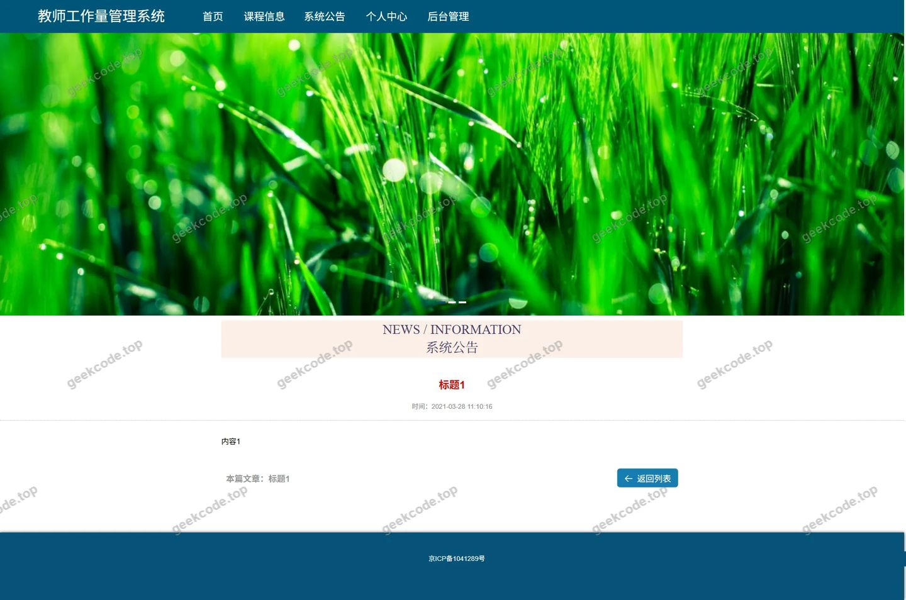</a>

<h4>前台-分类信息列表</h4>

<h4>前台-工作量列表</h4>

<h4>前台-工作量-详情</h4>

<a href="https://geekcode.top/archives/%E6%95%99%E5%B8%88%E5%B7%A5%E4%BD%9C%E9%87%8F%E7%AE%A1%E7%90%86%E7%B3%BB%E7%BB%9F?utm_source=github" title="查看完整源码">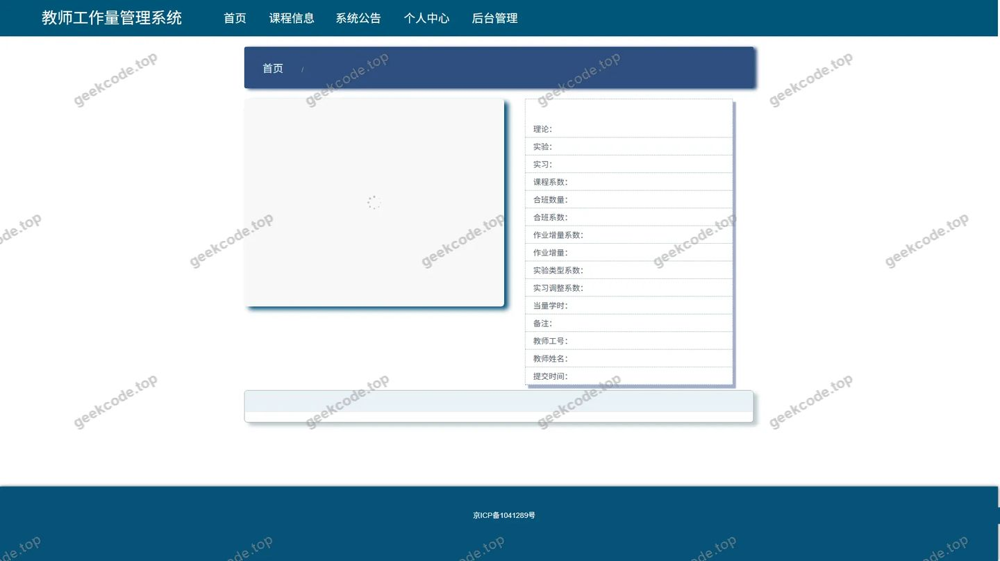</a>

<h3>后台管理端</h3>
<h4>后台-系统配置</h4>

<a href="https://geekcode.top/archives/%E6%95%99%E5%B8%88%E5%B7%A5%E4%BD%9C%E9%87%8F%E7%AE%A1%E7%90%86%E7%B3%BB%E7%BB%9F?utm_source=github" title="查看完整源码">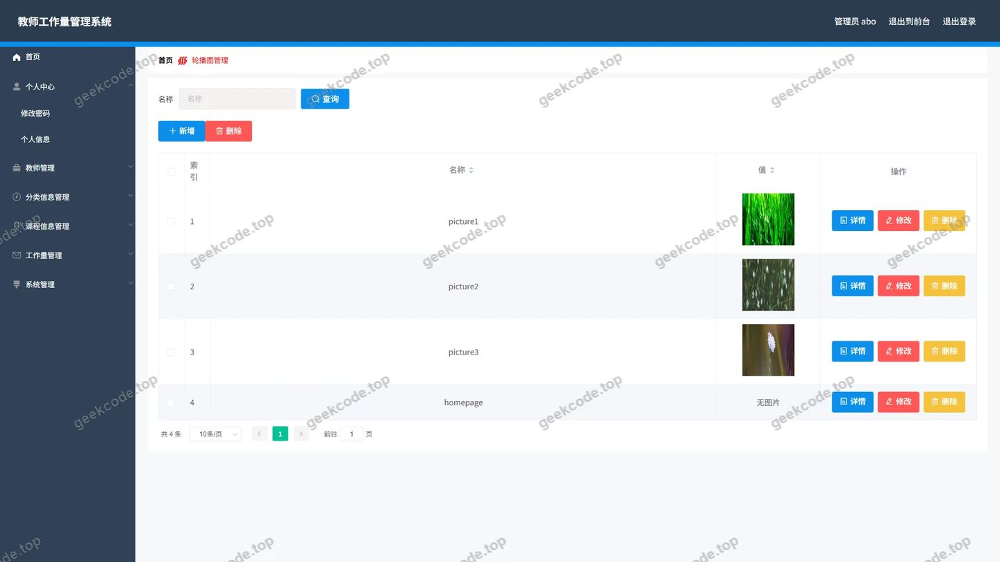</a>

<h4>后台-分类信息</h4>

<a href="https://geekcode.top/archives/%E6%95%99%E5%B8%88%E5%B7%A5%E4%BD%9C%E9%87%8F%E7%AE%A1%E7%90%86%E7%B3%BB%E7%BB%9F?utm_source=github" title="查看完整源码">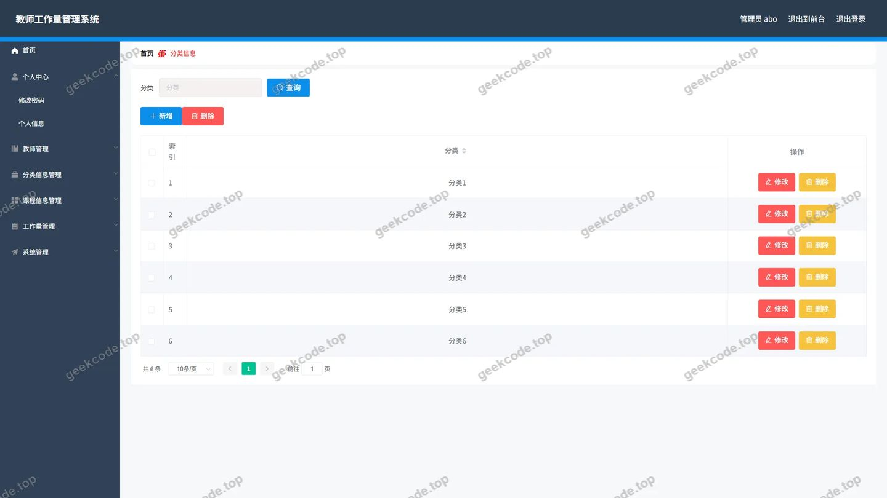</a>

<h4>后台-工作量</h4>

<a href="https://geekcode.top/archives/%E6%95%99%E5%B8%88%E5%B7%A5%E4%BD%9C%E9%87%8F%E7%AE%A1%E7%90%86%E7%B3%BB%E7%BB%9F?utm_source=github" title="查看完整源码">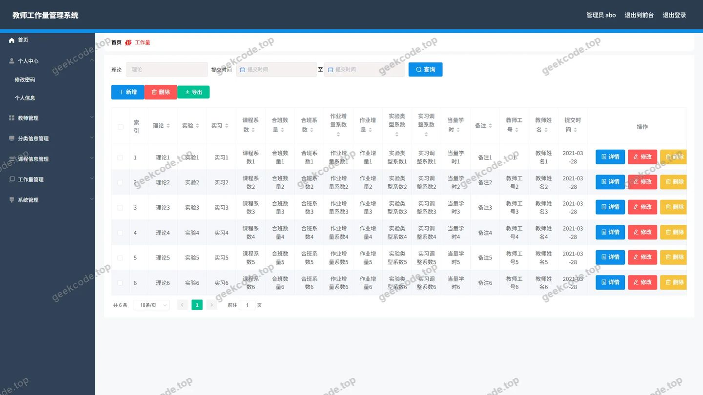</a>

<h4>后台首页</h4>

<a href="https://geekcode.top/archives/%E6%95%99%E5%B8%88%E5%B7%A5%E4%BD%9C%E9%87%8F%E7%AE%A1%E7%90%86%E7%B3%BB%E7%BB%9F?utm_source=github" title="查看完整源码">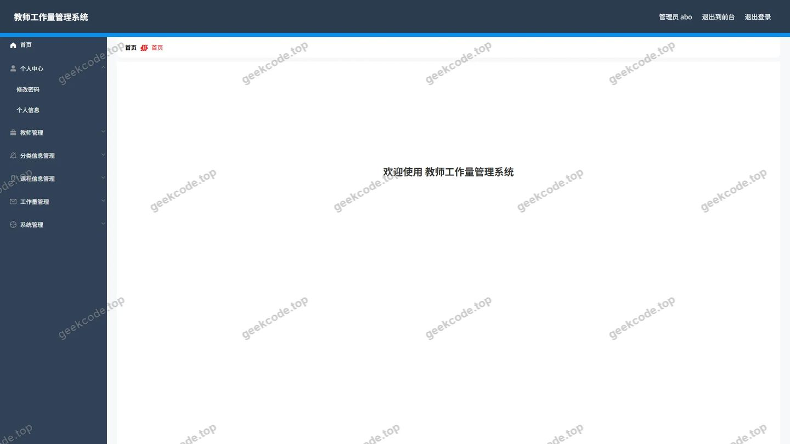</a>

<h4>后台-教师</h4>

<a href="https://geekcode.top/archives/%E6%95%99%E5%B8%88%E5%B7%A5%E4%BD%9C%E9%87%8F%E7%AE%A1%E7%90%86%E7%B3%BB%E7%BB%9F?utm_source=github" title="查看完整源码">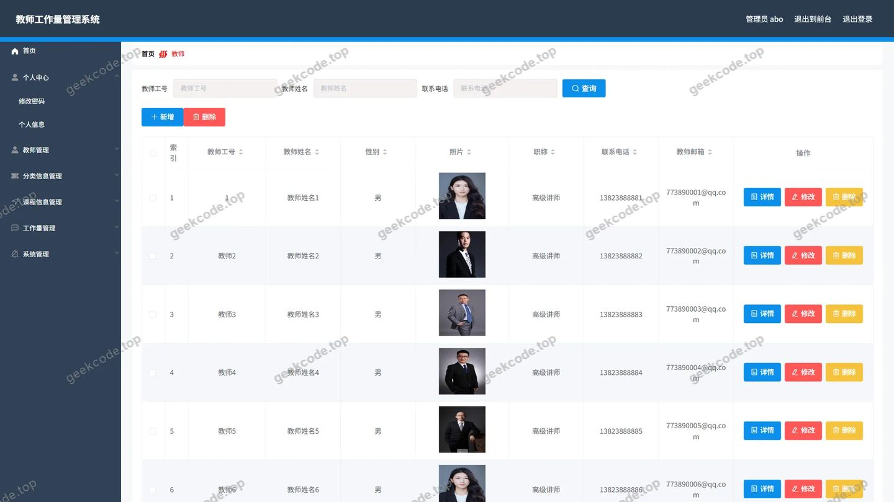</a>

<h4>后台-课程信息</h4>

<a href="https://geekcode.top/archives/%E6%95%99%E5%B8%88%E5%B7%A5%E4%BD%9C%E9%87%8F%E7%AE%A1%E7%90%86%E7%B3%BB%E7%BB%9F?utm_source=github" title="查看完整源码">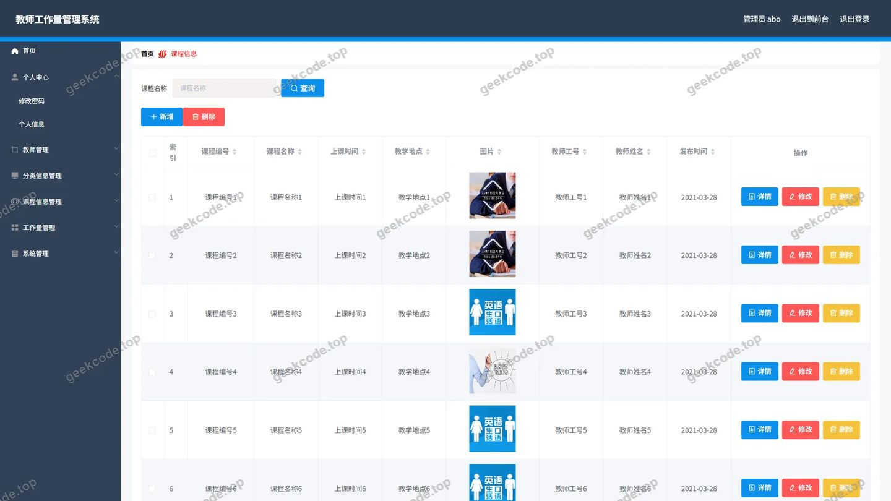</a>

<h4>后台-登录</h4>

<h4>后台-公告信息</h4>

<a href="https://geekcode.top/archives/%E6%95%99%E5%B8%88%E5%B7%A5%E4%BD%9C%E9%87%8F%E7%AE%A1%E7%90%86%E7%B3%BB%E7%BB%9F?utm_source=github" title="查看完整源码">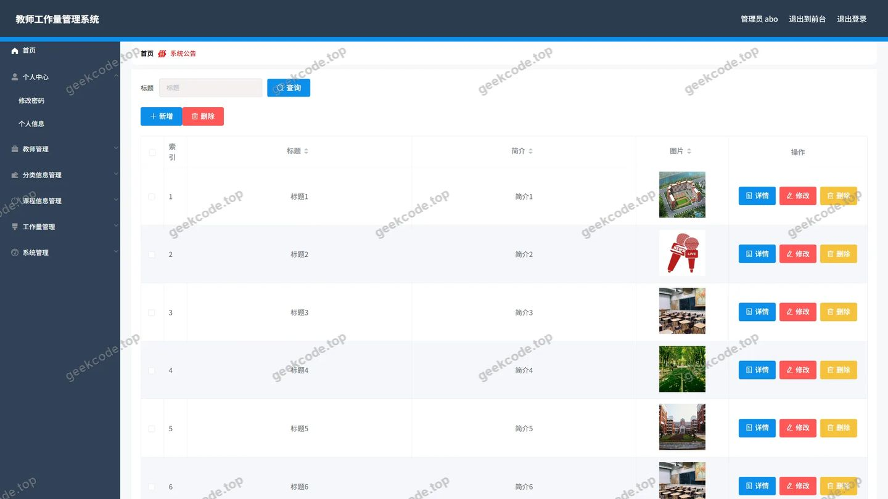</a>

---

## 获取完整源码

| 项目 | 说明 |
| --- | --- |
| 项目名 | 教师工作量管理系统 |
| 运行截图 | 本文 20 张（站点带水印原图，仓库 `images/` 目录） |
| 完整源码 | [https://geekcode.top/archives/%E6%95%99%E5%B8%88%E5%B7%A5%E4%BD%9C%E9%87%8F%E7%AE%A1%E7%90%86%E7%B3%BB%E7%BB%9F?utm_source=github](https://geekcode.top/archives/%E6%95%99%E5%B8%88%E5%B7%A5%E4%BD%9C%E9%87%8F%E7%AE%A1%E7%90%86%E7%B3%BB%E7%BB%9F?utm_source=github) |
| 咨询微信 | **ir9372**（备注：jingpin-yuanma） |
| 更多项目 | [极客代码 geekcode.top](https://geekcode.top/?utm_source=github) |

> 需要源码、部署、改配置、跑不起来等问题，加微信 ir9372 沟通，说明项目名即可。
